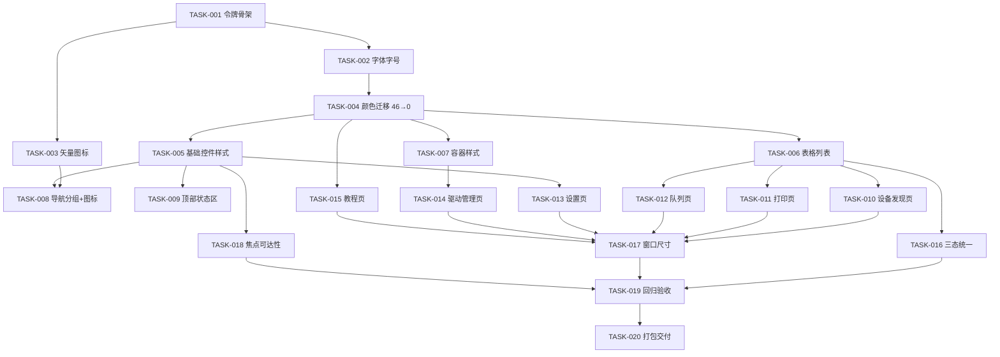

# 界面优化 实施计划（Plan）

> 版本：v1.0 ｜ 日期：2026-10-14 ｜ 输入：[`spec-ui-refresh.md`](spec-ui-refresh.md) v1.1
> 基线：`ui-baseline-f53b202` ｜ 目标：Windows 11 Fluent 风格改造，**不破坏原功能**

---

## 1. 项目概述

| 项 | 内容 |
|---|---|
| 项目名称 | PrinterMate 界面现代化改造 |
| 计划周期 | 2026-10-14 ~ |
| **总工时预估** | **32.5 小时**（20 个任务，已含缓冲） |
| 任务总数 | **20 个**，分 7 个阶段 |
| 代码改动面 | `PrinterMate.App` 单项目（XAML 为主 + ViewModel 仅加展示属性） |
| **不改动** | `Core` / `Security` / `Catalog` / `Printing` / `Interop` / `Elevated` |

### 贯穿全程的三条硬约束

1. **不新增任何 NuGet 依赖**
2. **不改功能逻辑、不改交互流程**（重排的是位置与显隐，不是步骤与顺序）
3. **安全校验与许可确认不弱化** —— 风险提示、许可勾选框、三重校验说明必须仍在原位可见

---

## 2. 🔒 回归门禁（每个任务提交前必须全过）

> 这是"不破坏原功能"的执行保障。**任何一个门禁不过，禁止进入下一个任务。**

| # | 门禁 | 判定 |
|---|---|---|
| G1 | `dotnet build PrinterMate.slnx` | **0 错误** |
| G2 | `dotnet test tests/PrinterMate.UnitTests` | **395 个全过**（0 失败，1 跳过） |
| G3 | 启动程序，**逐页实际点开 6 个页面** | 无 XAML 加载异常、无空白页 |
| G4 | 硬编码颜色计数 `grep '#[0-9A-Fa-f]{6}'` | **单调下降**，Phase 5 结束时 = 0 |
| G5 | 构建后启动 EXE，进程响应正常 | 界面可交互 |

**G3 的说明**：编译通过 ≠ 页面能加载。XAML 错误只在页面被实例化时才抛出，
所以必须**实际点击导航**逐页验证（本会话已踩过此坑，故列为强制项）。

---

## 3. 任务分解

### Phase 0：地基（4.5h）

#### TASK-001: 建立设计令牌资源字典骨架
- **优先级**：P0 ｜ **工时**：2h ｜ **依赖**：无 ｜ **模块**：`App/Resources/`
- **描述**：新建 `Resources/Tokens.xaml`（颜色/字号/间距/圆角/阴影的语义化令牌），
  在 `App.xaml` 合并引入。
- **验收标准**：
  - [ ] 令牌按**语义**命名（`Brush.Accent`、`Brush.TextSecondary`、`Size.Body`、`Space.M`、`Radius.Card`）
  - [ ] 不出现按外观命名的键（禁止 `Blue1`、`Color2`）
  - [ ] G1–G3 全过
- **技术要点**：令牌值为**静态资源**（非动态），避免主题切换开销；数值取自现行 Fluent 规范。

#### TASK-002: 字体与字号体系
- **优先级**：P0 ｜ **工时**：1h ｜ **依赖**：TASK-001 ｜ **模块**：`Tokens.xaml`、`App.xaml`
- **描述**：改用系统 UI 字体，建立字号阶梯并应用到全局隐式样式。
- **验收标准**：
  - [ ] 字体族：`Segoe UI, Microsoft YaHei UI`
  - [ ] 正文 **14px**、次要 **12.5px**、禁用 **12px**、小标题 16px、大标题 20px
  - [ ] 全应用无硬编码 `FontSize` 遗留（除令牌定义处）
  - [ ] G1–G3 全过

#### TASK-003: 矢量图标资源
- **优先级**：P0 ｜ **工时**：1.5h ｜ **依赖**：TASK-001 ｜ **模块**：`Resources/Icons.xaml`
- **描述**：以 `Geometry` 资源形式定义导航与状态所需图标（约 10 个），
  用 `Path` 渲染，**不引入图标库**。
- **验收标准**：
  - [ ] 图标以 `Geometry` 资源集中定义，页面通过 `Data="{StaticResource Icon.X}"` 引用
  - [ ] 每个图标在 16px / 20px 下清晰可辨
  - [ ] 缺失图标时回退纯文字，不导致导航项消失
  - [ ] G1–G4 全过（新增无硬编码颜色）

---

### Phase 1：令牌迁移与控件层（8h）

#### TASK-004: 颜色令牌迁移（46 → 0）
- **优先级**：P0 ｜ **工时**：3h ｜ **依赖**：TASK-002 ｜ **模块**：6 个页面 XAML + `App.xaml`
- **描述**：把 46 处硬编码颜色（教程 22、驱动管理 15、设备发现 5、设置 4）逐一替换为语义令牌。
- **验收标准**：
  - [ ] 页面 XAML 中 `#RRGGBB` / `#AARRGGBB` 计数 **= 0**
  - [ ] 颜色语义与原来一致（不因迁移而改变"红=危险、橙=警示、绿=成功"的含义）
  - [ ] G1–G4 全过（G4 计数归零）
- **技术要点**：⚠ 这是"视觉统一"的关键任务。**逐个替换后立即目视核对**，避免把警示色误映射为普通色。

#### TASK-005: 基础控件样式（按钮/输入/下拉/复选框）
- **优先级**：P0 ｜ **工时**：2h ｜ **依赖**：TASK-004 ｜ **模块**：`Resources/Controls.xaml`
- **描述**：以隐式样式统一控件外观，覆盖**全部状态**。
- **验收标准**：
  - [ ] 状态完整：默认 / 悬停 / 按下 / 禁用 / **焦点**
  - [ ] 圆角、内边距、字号统一来自令牌
  - [ ] 按钮具备主次层级（主操作 / 次要操作视觉可区分）
  - [ ] G1–G3 全过

#### TASK-006: 表格与列表现代化（对应痛点 2）
- **优先级**：P0 ｜ **工时**：2h ｜ **依赖**：TASK-004 ｜ **模块**：`Resources/DataViews.xaml`
- **描述**：统一 `DataGrid` / `ListBox` 外观。
- **验收标准**：
  - [ ] 表头样式（背景、字重、下边框）、行高一致
  - [ ] 行**悬停态**、**选中态**、斑马纹（可选，需保证不刺眼）
  - [ ] **空状态占位**：列表为空时显示一行提示文案，不再是空白
  - [ ] 保留 `EmbeddedGrid` / `EmbeddedList` 的**禁用内层滚动 + 关闭虚拟化**规则（性能红线）
  - [ ] G1–G3 全过

#### TASK-007: 容器样式（卡片 / Expander / 滚动条 / 分组）
- **优先级**：P0 ｜ **工时**：1h ｜ **依赖**：TASK-004 ｜ **模块**：`Resources/Containers.xaml`
- **描述**：统一页面分区容器、折叠区、滚动条外观。
- **验收标准**：
  - [ ] `Card` 样式统一为 Fluent 圆角 + 轻边框 + 无重阴影
  - [ ] `Expander` 展开/收起图标现代化，标题栏悬停态
  - [ ] 滚动条细化，宽度收窄、无箭头按钮
  - [ ] G1–G3 全过

---

### Phase 2：外壳与导航（3h）

#### TASK-008: 导航分组 + 图标（对应痛点 5）
- **优先级**：P0 ｜ **工时**：2h ｜ **依赖**：TASK-003、TASK-005 ｜ **模块**：`MainWindow.xaml`
- **描述**：导航由"6 项纯文字平铺"改为"图标 + 两组"。
- **验收标准**：
  - [ ] 分组：**核心流程**（新手必读 / 设备发现与连接 / 打印与测试页 / 任务队列与状态）、
        **配置与帮助**（驱动管理 / 设置）
  - [ ] 每项含矢量图标 + 选中态高亮（左侧强调条）
  - [ ] **页面索引与 `Pages` 集合顺序保持一致**（否则导航会跳错页 —— 高风险点）
  - [ ] G1–G3 全过

#### TASK-009: 顶部状态与反馈区统一（F7）
- **优先级**：P1 ｜ **工时**：1h ｜ **依赖**：TASK-005 ｜ **模块**：`MainWindow.xaml`
- **描述**：顶部的"操作 / 结果 / 建议"三行 `TextBlock` 改为统一的**信息条**组件（按级别着色 + 图标）。
- **验收标准**：
  - [ ] 三种级别（成功 / 警示 / 错误）视觉可区分
  - [ ] 无内容时**不占位**（不留下空白条）
  - [ ] 长文本换行不撑破布局
  - [ ] G1–G3 全过

---

### Phase 3：主流程页面重排（6h）

#### TASK-010: 设备发现页重排（最高频页面）
- **优先级**：P0 ｜ **工时**：2h ｜ **依赖**：TASK-006 ｜ **模块**：`DeviceDiscoveryView.xaml`
- **验收标准**：
  - [ ] 1280×800 下**主操作首屏可见**（「扫描 USB 打印机」与「一键连接」无需滚动）
  - [ ] 教程卡片收敛为**一行摘要 + 可展开详情**
  - [ ] 两个 DataGrid 保持 `EmbeddedGrid`（单一滚动宿主）
  - [ ] 保留「状态」列含义说明（可折叠，但不得删除）
  - [ ] G1–G3 全过

#### TASK-011: 打印与测试页重排
- **优先级**：P1 ｜ **工时**：1h ｜ **依赖**：TASK-006 ｜ **模块**：`PrintingView.xaml`
- **验收标准**：
  - [ ] 主操作（打印测试页 / 打印文件）首屏可见
  - [ ] 危险操作（如重启后台服务）视觉上**弱化且明确标注**
  - [ ] G1–G3 全过

#### TASK-012: 队列与状态页重排
- **优先级**：P1 ｜ **工时**：1.5h ｜ **依赖**：TASK-006 ｜ **模块**：`QueueView.xaml`
- **验收标准**：
  - [ ] 队列列表为主视觉，操作按钮紧邻列表
  - [ ] 空队列显示空状态占位
  - [ ] G1–G3 全过

#### TASK-013: 设置页重排
- **优先级**：P1 ｜ **工时**：1.5h ｜ **依赖**：TASK-005 ｜ **模块**：`SettingsView.xaml`
- **验收标准**：
  - [ ] 设置项按主题分组，每组有标题与说明
  - [ ] 诊断导出等低频操作下沉
  - [ ] G1–G3 全过

---

### Phase 4：长页面重构（5h）

#### TASK-014: 驱动管理页重排与文字收敛（最大页面）
- **优先级**：P0 ｜ **工时**：3h ｜ **依赖**：TASK-007 ｜ **模块**：`DriverManagementView.xaml`
- **验收标准**：
  - [ ] 在线补齐区（主操作）排在**首屏**
  - [ ] 大段说明文字改为"一行摘要 + 可展开"，**纵向长度显著下降**
  - [ ] ⚠ **红线校验**：许可勾选框、白名单说明、三重校验说明、风险提示**仍在原位可见、仍需显式操作、语义不变**
  - [ ] 4 个折叠区块（待办清单 / 许可开关 / 品牌统计 / 条目树）保留折叠能力
  - [ ] 表格样式来自 TASK-006，无页面内局部样式
  - [ ] G1–G3 全过

#### TASK-015: 教程页可扫读重构
- **优先级**：P1 ｜ **工时**：2h ｜ **依赖**：TASK-004 ｜ **模块**：`TutorialView.xaml`
- **验收标准**：
  - [ ] 长段落改为**步骤卡片 + 编号**，可扫读
  - [ ] 22 处硬编码颜色全部令牌化
  - [ ] 内容**信息量不减少**（只是排版变化，不删知识点）
  - [ ] G1–G4 全过

---

### Phase 5：统一收尾（5h）

#### TASK-016: 空态 / 加载态 / 错误态统一（F8）
- **优先级**：P1 ｜ **工时**：1.5h ｜ **依赖**：TASK-006 ｜ **模块**：`Resources/States.xaml` + 各页
- **验收标准**：
  - [ ] 三态共用同一组件与视觉语言
  - [ ] 空态含"下一步该做什么"的引导文案
  - [ ] G1–G3 全过

#### TASK-017: 窗口尺寸与内容裁切（F9）
- **优先级**：P1 ｜ **工时**：1h ｜ **依赖**：Phase 3、Phase 4 ｜ **模块**：`MainWindow.xaml`
- **验收标准**：
  - [ ] 设定合理默认尺寸与**最小尺寸**
  - [ ] 在最小尺寸下 6 个页面**均不出现控件被裁切**
  - [ ] G1–G3 全过

#### TASK-018: 键盘可达性与焦点态（F10）
- **优先级**：P1 ｜ **工时**：1h ｜ **依赖**：TASK-005 ｜ **模块**：各页
- **验收标准**：
  - [ ] 所有可交互控件的焦点态**清晰可见**（不得因模板替换而丢失焦点框）
  - [ ] Tab 顺序符合阅读顺序
  - [ ] G1–G3 全过

#### TASK-019: 回归验收（逐页实测）
- **优先级**：P0 ｜ **工时**：1.5h ｜ **依赖**：全部前置 ｜ **模块**：全项目
- **验收标准**：
  - [ ] **G1–G5 全部门禁通过**
  - [ ] 硬编码颜色 **= 0**
  - [ ] 6 个页面逐页点开截图存档
  - [ ] 395 个单元测试全过
  - [ ] 真机集成测试结果与基线一致
  - [ ] 关键流程实测：扫描 USB → 一键连接 → 打测试页

---

### Phase 6：交付（1h）

#### TASK-020: 重新打包 + 备份 + 文档
- **优先级**：P0 ｜ **工时**：1h ｜ **依赖**：TASK-019 ｜ **模块**：`dist/`
- **验收标准**：
  - [ ] 重新发布单文件 EXE，实测启动
  - [ ] `dist` 中驱动文件数 **= 0**（不得引入任何厂商驱动）
  - [ ] 打新标签 `ui-v1`，备份源码 zip + git bundle
  - [ ] 更新 `README.md` 的界面截图与说明（如有）

---

## 4. 任务依赖图

**关键路径**：T001 → T002 → T004 → T005 → T008 → T010 → T017 → T019 → T020

**可并行项**：T006 / T007 可并行；T010–T013、T015 之间无强依赖；
T016 / T018 可在任意 P0 完成后穿插执行。

---

## 5. 里程碑

| 里程碑 | 完成标准 | 对应任务 |
|---|---|---|
| **M1 地基就绪** | 令牌/字体/图标三层可用，构建与测试全绿 | T001–T003 |
| **M2 视觉统一** | 硬编码颜色 = 0；四类控件样式统一；导航双层分组带图标 | T004–T009 |
| **M3 页面重排完成** | 6 个页面全部重排，主操作首屏可见 | T010–T015 |
| **M4 回归通过** | G1–G5 全过；395 测试全绿；6 页实测无异常 | T016–T019 |
| **M5 交付** | 新 EXE 实测可启动；`dist` 零驱动文件；已打标签备份 | T020 |

---

## 6. 风险预案

| 风险 | 可能性 | 影响 | 应对措施 |
|---|---|---|---|
| 全局控件模板替换导致**焦点框消失** | 中 | 键盘不可用 | TASK-018 专项检查；模板中显式保留 `FocusVisualStyle` |
| 页面 XAML 错误**只在点开时抛** | **高** | 用户看到崩溃 | 门禁 G3 强制逐页点开验证（本会话已因此踩坑） |
| 导航重排导致**页面索引错位** | 中 | 点 A 跳到 B | TASK-008 明确要求校验 `Pages` 集合顺序，并逐项点击验证 |
| 表格虚拟化关闭导致**长列表卡顿** | 中 | 滚动卡 | 沿用既有 `EmbeddedGrid` 规则，不引入新的内层滚动宿主 |
| 文字收敛时**误删风险提示** | 中 | **合规暴露** | 门禁中单列"红线校验"项；风险提示类文案只可调排版，不可移入折叠区 |
| 颜色语义映射错误（警示色变普通色） | 中 | 误导用户 | TASK-004 要求逐个替换后目视核对 |
| 工时预估偏差 > 30% | 中 | 排期失效 | 每完成一个 Phase 复盘一次，触发 Replan |

### 回退方案

- 基线标签 `ui-baseline-f53b202`；源码与全历史已备份至 `E:\trae_projects\printer-backups\`
- **每个任务单独提交**，任一出问题可 `git revert` 单个提交，不影响其他任务

---

## 7. 执行规则

1. **一次一个任务**：完成并过门禁后再开始下一个
2. **每个任务一次提交**：提交信息含任务编号（如 `ui(T004): 颜色令牌迁移 46→0`）
3. **门禁不过不推进**：尤其 G2（395 测试）与 G3（逐页点开）
4. **每个 Phase 结束复盘**：实际工时 vs 预估，偏差 > 30% 触发 Replan
5. **状态标记**：⏳ 待开始 ｜ 🚧 进行中 ｜ ✅ 已完成 ｜ 🚫 被阻塞 ｜ ⏭️ 已跳过

### 任务看板（初始）

| 阶段 | 任务 | 状态 |
|---|---|---|
| Phase 0 | T001 令牌骨架 / T002 字体字号 / T003 矢量图标 | ⏳ ⏳ ⏳ |
| Phase 1 | T004 颜色迁移 / T005 控件样式 / T006 表格 / T007 容器 | ⏳ ⏳ ⏳ ⏳ |
| Phase 2 | T008 导航 / T009 状态区 | ⏳ ⏳ |
| Phase 3 | T010 设备发现 / T011 打印 / T012 队列 / T013 设置 | ⏳ ⏳ ⏳ ⏳ |
| Phase 4 | T014 驱动管理 / T015 教程 | ⏳ ⏳ |
| Phase 5 | T016 三态 / T017 窗口 / T018 焦点 / T019 回归 | ⏳ ⏳ ⏳ ⏳ |
| Phase 6 | T020 打包交付 | ⏳ |

---

## 8. 预估工时汇总

| 阶段 | 工时 |
|---|---|
| Phase 0 地基 | 4.5h |
| Phase 1 令牌与控件层 | 8h |
| Phase 2 外壳与导航 | 3h |
| Phase 3 主流程页面 | 6h |
| Phase 4 长页面重构 | 5h |
| Phase 5 收尾 | 5h |
| Phase 6 交付 | 1h |
| **小计** | **32.5h** |
| 缓冲（已含） | — |
| **合计** | **32.5h** |
